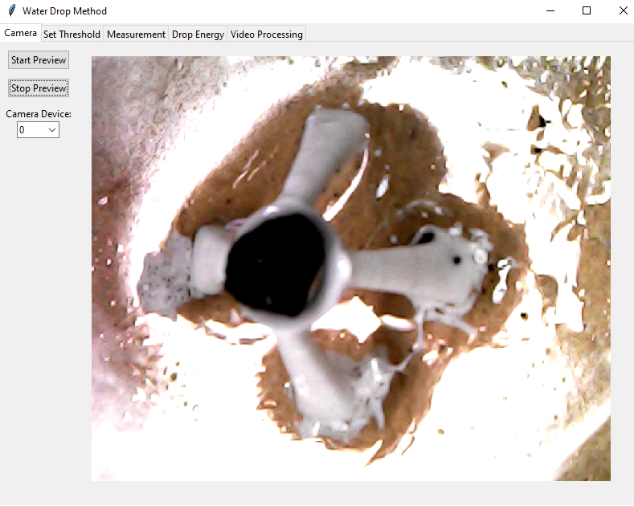
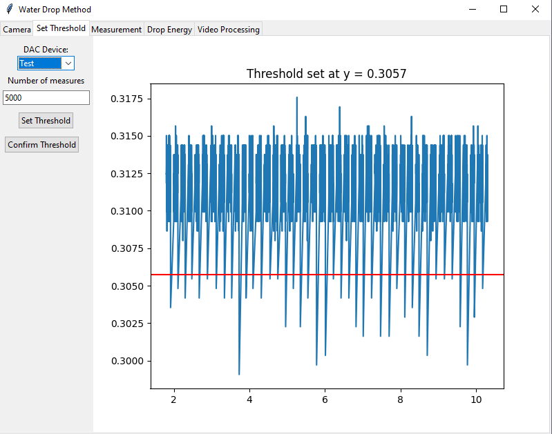
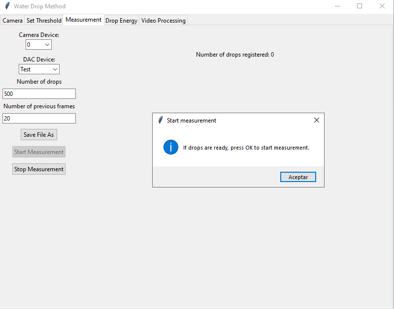
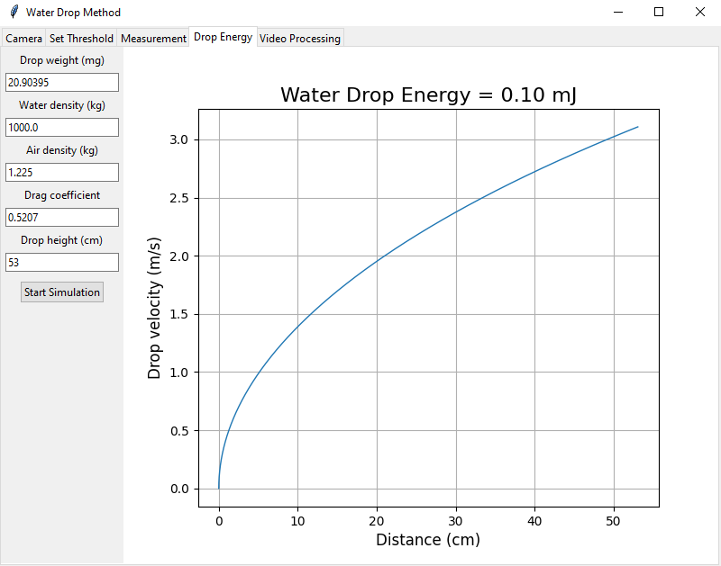
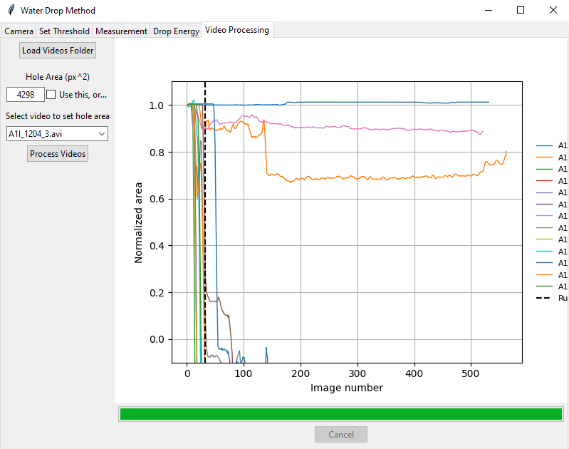
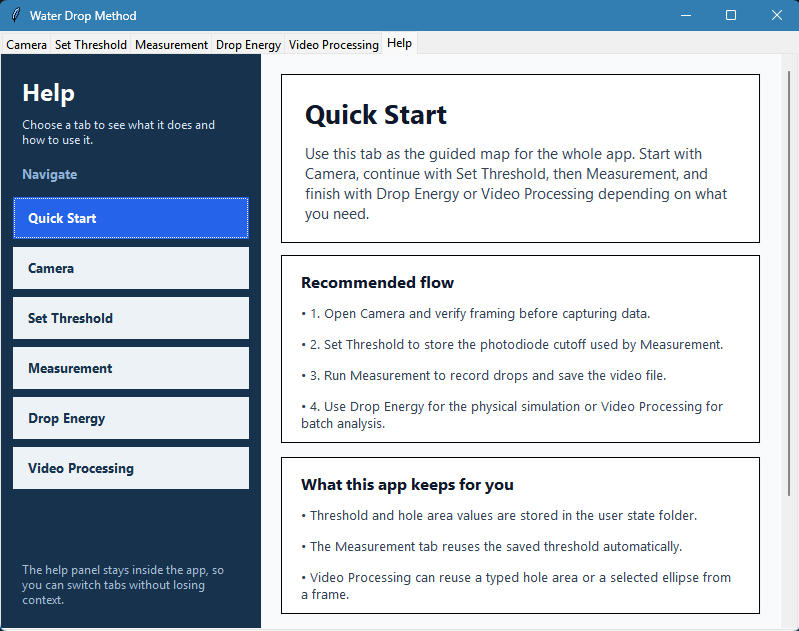

# Water Drop Method


Desktop app based on Tkinter to implement the Water Drop Method and determine the Sample Breakdown Energy of water-stable soil aggregates.

## Distribution

The application is currently distributed as a compiled build for Windows 64-bit.

- GitHub Releases: https://github.com/alencina-faa/Water-drop-method/releases
- SourceForge: https://sourceforge.net/projects/water-drop-method/

## Highlights

- GUI workflow with tabs for camera preview, threshold setup, measurement, drop energy, and video processing.
- Runtime state persisted per user on Windows.
- Package-safe import structure for src-layout projects.
- Basic automated test suite with structural and persistence checks.

## Project Structure

- `src/Water_drop_method`: application package
- `tests`: automated tests
- `output`: local build artifacts (ignored by git)

## Requirements

- Python 3.10+
- Dependencies:
  - `pillow`
  - `numpy`
  - `matplotlib`
  - `opencv-python`
  - `nidaqmx` and/or `pyserial`

## Install (Editable)

```bash
python -m venv .venv
.venv\Scripts\activate
pip install -e .
```

## Run

```bash
python -m Water_drop_method
```

## Run the shadow-triggered snapshot script

The standalone console script asks before calibration and measurement, collects Arduino photodiode readings, and displays them in a gridded plot. Enter and confirm the threshold in volts in the console. It then displays one webcam snapshot per shadow event. Close each snapshot window to resume detection; it rearms only after the photodiode reading returns to or above the threshold. Press `Ctrl+C` to stop measurement.

```bash
python -m Water_drop_method.Snapshoot_triggered_by_shadows
```

The defaults are Arduino port `COM3`, webcam index `0`, and `5000` calibration samples. Override them with `--port`, `--camera`, or `--samples`.

## Run Tests

```bash
pytest -q
```

## Tabs Guide

| Tab | What it is used for | Main actions | Screenshot |
| --- | --- | --- | --- |
| Camera | Preview the camera feed and validate framing before measurements. | Select camera device, Start Preview, Stop Preview. |  |
| Set Threshold | Compute and confirm the photodiode threshold. | Select DAC device, set number of measures, Set Threshold, Confirm Threshold. |  |
| Measurement | Execute the drop measurement workflow. | Select camera and DAC, set drops and previous frames, Save File As, start/stop acquisition. |  |
| Pump Control | Configure, calibrate, and automate the 12V peristaltic pump replacing the Mariotte tube. | Connect COM/Simulation, adjust pulse/interval, Preset 6.0 mL/min, Deliver 1 Drop, Start/Stop pump. | - |
| Drop Energy | Estimate drop velocity and impact energy from physical parameters. | Configure physical values and run Start Simulation. |  |
| Video Processing | Batch-process videos and analyze normalized area over frames. | Load videos folder, define hole area, Process Videos, inspect plots and outputs. |  |
| Help | Browse a guided, clickable explanation for every tab inside the app. | Select a topic on the left, read the step-by-step guidance on the right. |  |

## Peristaltic Pump & Hardware Setup

For wiring diagrams, MOSFET connection schematics, Arduino/ESP32 sketches, and 6.0 mL/min calibration details, consult [docs/peristaltic_pump_guide.md](docs/peristaltic_pump_guide.md).


## Runtime State Files

The app stores runtime state in a per-user writable folder:

- Windows: `%APPDATA%\\WaterDropMethod`
- Fallback: `<home>/WaterDropMethod`

Persisted files:

- `threshold.txt`
- `hole_area.txt`
- `pump_timing.txt`

## Legacy Migration

If legacy `threshold.txt` or `hole_area.txt` files are found in the current working directory, the app performs a one-time best-effort copy to the per-user state folder when those values are requested.

These runtime files are intentionally excluded from version control.

---

## Update: Hackathon Agro 2026

Modernización y automatización del sistema para reemplazar el tubo de Mariotte tradicional por una **bomba peristáltica dosificadora de 12V** accionada por **módulo dual MOSFET** y microcontrolador (**Arduino Uno / ESP32-C3**).

### Principales Mejoras Implementadas:

1. **Control de Flujo Continuo sin Bloqueos:**
   - Firmware en C++ (`.ino`) para Arduino / ESP32 basado en temporización no bloqueante con `millis()`, eliminando las pausas de `delay()`.
   - Comunicación bidireccional por puerto Serial (115200 baudios) con protocolo de comandos de texto (`START`, `STOP`, `DROP`, `SET <pulso> <intervalo>`).
2. **Nueva Pestaña "Pump Control" en la Aplicación:**
   - Detección automática de puertos COM (incluye modo *Simulation* para pruebas sin hardware).
   - Calibración en tiempo real de pulso de encendido (`pulse_ms`) e intervalo entre gotas (`interval_ms`).
   - Valores predeterminados del banco experimental (**14 ms de pulso / 200 ms de intervalo $\approx$ 6.0 mL/min**).
   - Botón **`⭐ Save as Default...`** con diálogo de confirmación para persistir nuevas calibraciones en `%APPDATA%\WaterDropMethod\pump_timing.txt`.
   - Botón **`💧 1 Drop (Prime)`** para purgado rápido de mangueras y cebado de la aguja.
   - Tablero en vivo con indicadores de cadencia (gotas/s), caudal (mL/min) y período (ms).
3. **Automatización Sincronizada con la Medición:**
   - Coordinación directa con la pestaña *Measurement*: la bomba arranca sola al presionar *Start Measurement* y se detiene automáticamente al registrar el total de gotas programadas (o presionar *Stop*).
4. **Tutorial Guiado Interactivo:**
   - Botón **`📖 Tutorial: Paso a Paso`** accesible desde las pestañas *Measurement* y *Pump Control*, con una guía visual en 5 pasos para operar el equipo de punta a punta.
5. **Firmware Dual para un Solo Microcontrolador:**
   - Sketch integrado (`WDM_photodiode_and_pump.ino`) que permite leer el fotodiodo analógico y gobernar la bomba desde una única placa Arduino o ESP32-C3 sin interferencias.
6. **Módulo Python Modular y Reutilizable:**
   - Módulo independiente `pump_controller.py` con la clase `PeristalticPump`, ejecutable tanto desde la GUI como de forma autónoma desde scripts externos.
7. **Documentación Técnica y Esquemática:**
   - Diagramas de conexionado, especificaciones eléctricas y guía de calibración detallada en [`docs/peristaltic_pump_guide.md`](docs/peristaltic_pump_guide.md).

