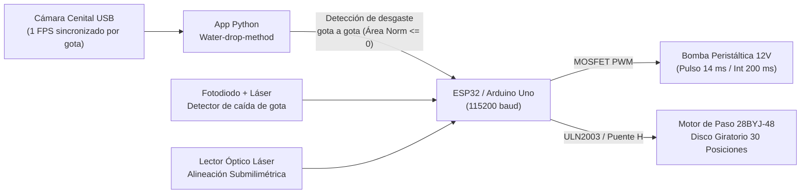

# Guía Técnica: Disco Giratorio de 30 Agregados + Lector Láser + Procesamiento de Desgaste en Tiempo Real

Este documento describe el diseño electromecánico, el conexionado de hardware (ESP32 / Arduino Uno con motor de paso **28BYJ-48 + driver ULN2003** y/o **motor DC con Puente H L298N/L9110** + **lector óptico láser**) y el algoritmo de visión artificial en tiempo real (gota a gota) implementado en `Water-drop-method-V2`.

---

## 1. Arquitectura del Dispositivo Automático de 30 Agregados

Para reducir el tiempo de dedicación exclusiva del operador de **2,5–4 horas a menos de 30 minutos** (tiempo requerido únicamente para colocar los 30 agregados secos tamizados de $3,35\text{ mm} - 4\text{ mm}$ sobre sus soportes al inicio del ensayo), el sistema incorpora un **carrusel o disco giratorio superior de 30 posiciones**:

### Geometría y Protección contra Salpicaduras (> 3 cm)
De acuerdo con el planteo técnico del Hackatón Agro 2026 y la tesis doctoral (Bocchio, 2026):
- **30 soportes individuales** distribuidos equitativamente cada $\Delta \theta = 360^\circ / 30 = 12^\circ$.
- Cada soporte posee un **orificio calibrado de $2,8\text{ mm}$ de diámetro** donde apoya un agregado de entre $3,35\text{ mm}$ y $4\text{ mm}$.
- **Protección contra salpicaduras**: El impacto de cada gota ($0,02\text{ g}$, energía cinética $\approx 0,102\text{ mJ}$ tras $52\text{ cm}$ de caída libre por aguja hipodérmica 18G) produce salpicaduras en un **radio de hasta $3\text{ cm}$**.
  - El disco giratorio mantiene una **separación de arco de $3,5\text{ cm}$** entre centros de soportes contiguos, resultando en un **diámetro de circunferencia de paso de $33,42\text{ cm}$** (radio $R = 16,71\text{ cm}$).
  - Adicionalmente, cuenta con **tabiques radiales antisalpicadura (baffles)** entre cada una de las 30 celdas y una cubierta superior con ventana exclusiva sobre la estación activa (Slot bajo la aguja), garantizando que los 29 agregados restantes permanezcan completamente secos antes de su turno.

---

## 2. Posicionamiento por Motor de Paso 28BYJ-48 + Lector Láser

### 2.1 Resolución Mecánica con 28BYJ-48 + ULN2003
- El motor **28BYJ-48** operado en secuencia de **medio paso (8 fases)** posee **$4096\text{ pasos por revolución}$** en su eje de salida.
- Avance nominal por muestra ($12^\circ$):
  $$\text{Pasos por soporte} = \frac{4096}{30} = 136,53 \approx 137\text{ pasos}$$
- Resolución lineal tangencial en el radio de $16,71\text{ cm}$:
  $$\Delta s = \frac{\pi \times 334,2\text{ mm}}{4096} \approx 0,25\text{ mm por medio paso}$$

### 2.2 Verificación por Lector Óptico Láser
Dado que el orificio de soporte mide $2,8\text{ mm}$ y la aguja 18G requiere alineación submilimétrica:
1. Cada uno de los 30 brazos del disco posee una **ranura/marca de indexación óptica** alineada exactamente con el centro del orificio de $2,8\text{ mm}$.
2. Al recibir el comando `CAROUSEL:NEXT` (cuando el agregado actual se rompe), el microcontrolador avanza rápidamente el primer $85\%$ del recorrido ($\approx 116\text{ pasos}$) y luego entra en **búsqueda fina paso a paso** monitoreando la entrada digital del **Lector Láser (`PIN_LASER_SENSOR`)**.
3. En el instante en que el haz láser detecta la marca del nuevo soporte (`ALIGNED=1`), el motor clava su posición exactamente debajo de la aguja y el sistema reanuda el bombeo de gotas para el nuevo agregado.

---

## 3. Esquema de Conexión (ESP32 / Arduino Uno)

El firmware integrado [`WDM_photodiode_and_pump.ino`](../src/Water_drop_method/WDM_photodiode_and_pump/WDM_photodiode_and_pump.ino) (o el firmware dedicado [`WDM_carousel_stepper.ino`](../src/Water_drop_method/WDM_carousel_stepper/WDM_carousel_stepper.ino)) soporta tanto **Arduino Uno** como **ESP32**:

| Componente | Pin ESP32 | Pin Arduino Uno | Descripción |
| :--- | :---: | :---: | :--- |
| **Fotodiodo (Detector de Gota)** | `GPIO 0 (A0)` | `A0` | Lectura analógica continua de corte de haz |
| **Bomba Peristáltica (MOSFET)** | `GPIO 4` | `D9` | Salida digital hacia Gate del módulo MOSFET (12V) |
| **ULN2003 `IN1` / Puente H `IN1`** | `GPIO 18` | `D4` | Fase A del motor 28BYJ-48 o Dirección A Puente H |
| **ULN2003 `IN2` / Puente H `IN2`** | `GPIO 19` | `D5` | Fase B del motor 28BYJ-48 o Dirección B Puente H |
| **ULN2003 `IN3` / Puente H `ENA`** | `GPIO 21` | `D6` | Fase C del motor 28BYJ-48 o Enable PWM Puente H |
| **ULN2003 `IN4`** | `GPIO 22` | `D7` | Fase D del motor 28BYJ-48 |
| **Lector Óptico Láser (`OUT`)** | `GPIO 23` | `D8` | Entrada digital de alineación de ranura (`LOW` = alineado) |

> **Nota sobre orden de bobinas del 28BYJ-48**: En la librería y secuencia de 8 medios pasos, los pines se activan en orden `IN1 - IN2 - IN3 - IN4` con desenergización automática (`disableCoils()`) al finalizar cada rotación para evitar calentamiento del motor durante el ensayo.

---

## 4. Procesamiento de Desgaste en Tiempo Real (Gota a Gota)

Basado en la metodología de procesamiento de imágenes de la tesis doctoral (Bocchio, 2026, Sección 2.3.1.6, págs. 53–54), la clase [`RealTimeWearAnalyzer`](../src/Water_drop_method/carousel_controller.py) evalúa cada fotograma capturado en el instante exacto en que cae una gota:

1. **Estabilización lumínica inicial**: Durante los primeros 20 fotogramas previos al goteo, la cámara estabiliza su balance de blancos automático.
2. **Fotograma Base (Frame 21)**:
   - Se convierte a escala de grises (`cv2.cvtColor(frame, cv2.COLOR_BGR2GRAY)`).
   - Se aplica umbral binario inverso con umbral fijo de `40` (`cv2.threshold(gray, 40, 255, cv2.THRESH_BINARY_INV)`), donde el agregado y el orificio del soporte aparecen como píxeles blancos (`255`) sobre el fondo metálico claro (`0`).
   - Se identifica el contorno externo de mayor área ($A_i$, área inicial del agregado) y se recorta automáticamente una **Región de Interés (ROI) fija** con un margen de `20 píxeles` por lado (`x-20, y-20, w+40, h+40`).
3. **Evaluación Gota a Gota**:
   - Con cada gota detectada por el fotodiodo, se recorta el fotograma en la ROI fija, se umbraliza a `40` y se obtiene el área del contorno máximo $A_c$ (acotada superiormente a $A_i$).
   - Se aplica un **promedio móvil de ventana 5** ($\bar{A}_c$) para filtrar vibraciones o salpicaduras instantáneas.
   - Se calcula el **Área Normalizada** en vivo:
     $$\text{Área Normalizada} = \frac{\bar{A}_c - A_s}{A_i - A_s}$$
     donde $A_s$ es el área en píxeles del orificio vacío del soporte ($2,8\text{ mm}$, configurable en la GUI, por defecto `4000 px²`).
4. **Criterio Automático de Ruptura y Cambio de Muestra**:
   - Cuando el agregado se disgrega y atraviesa el soporte de $2,8\text{ mm}$, el área medida alcanza el área del orificio ($\bar{A}_c \le A_s \implies \text{Área Normalizada} \le 0$).
   - En ese instante (o al alcanzar el máximo de 500 gotas si el agregado es ultraestable):
     1. El sistema **pausa automáticamente la bomba peristáltica** (`STOP`).
     2. Guarda el video `.avi` individual de la muestra (`muestra_slot01.avi`, `muestra_slot02.avi`, etc.) y registra las gotas hasta ruptura y la energía de ruptura ($E = N_{\text{gotas}} \times 0,102\text{ mJ}$).
     3. Envía el comando `CAROUSEL:NEXT` al ESP32/Arduino para **girar el disco hacia el siguiente agregado hasta que el lector láser confirma la alineación**.
     4. Reinicia el analizador de desgaste con el nuevo agregado y reanuda la bomba peristáltica hasta completar los **30 agregados**.

